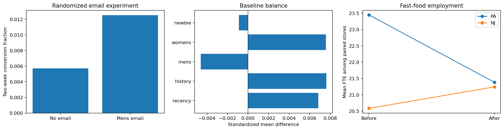

# Causal inference with real experiments and policy data

Did a randomized email affect conversion? How did employment change across NJ and PA after the 1992 minimum-wage increase?

## Data and provenance

- [Kevin Hillstrom email marketing randomized experiment (2008)](http://www.minethatdata.com/Kevin_Hillstrom_MineThatData_E-MailAnalytics_DataMiningChallenge_2008.03.20.csv): 64,000 input rows. Original 64,000 rows; both pipelines preselect Mens E-Mail versus No E-Mail. Womens E-Mail is excluded before analysis. Two-week conversion outcome; no retention or lifetime-value labels are invented. Raw SHA-256: `0e5893329d8b93cefecc571777672028290ab69865718020c78c7284f291aece`.
- [Card and Krueger New Jersey/Pennsylvania fast-food study (1992)](https://davidcard.berkeley.edu/data_sets/njmin.zip): 410 input rows. Original SHEET 407 is reused across two distinct state/chain records; immutable row ID preserves all 410 rows. Fixed-width parsing per original codebook; FTE=full-time + managers + 0.5 part-time. Paired complete observed interviews only; closed/nonresponding stores excluded, with counts reported. Raw SHA-256: `41a29aec6b489658b20030d044a2b20a5f5a04b871cde41df057afd6013ba587`.

## Design

The email analysis preselects Mens E-Mail versus No E-Mail and reports intention-to-treat conversion risk differences with independent-unit Welch intervals, sample-ratio checks and preassignment balance. The policy analysis computes paired store FTE changes, then the NJ-minus-PA difference with store-level Welch uncertainty. Reusing each store before and after preserves pairing. Neither analysis uses hidden potential outcomes.

## Results

| Measure | Value |
|---|---:|
| experiment rows | 42613 |
| experiment control rate | 0.00572609 |
| experiment treatment rate | 0.0125311 |
| conversion risk difference | 0.00680501 |
| conversion ci low | 0.00500007 |
| conversion ci high | 0.00860994 |
| sample ratio p | 0.996135 |
| max absolute baseline smd | 0.00761287 |
| stores original | 410 |
| stores complete | 378 |
| stores excluded | 32 |
| nj stores complete | 304 |
| pa stores complete | 74 |
| employment did fte | 2.72192 |
| employment ci low | 0.061795 |
| employment ci high | 5.38204 |

## Assumptions and limitations

The email experiment requires random assignment, no interference and consistent outcome measurement. The observational DiD requires parallel counterfactual trends and no state-specific coincident shocks; only two survey waves exist, so pretrends cannot be tested. Independent-store intervals do not account for state-level common shocks (only two states); they must not be read as robust policy-level inference. Complete interviews exclude closures/nonresponse; attrition may bias the policy estimate. These historical studies do not establish present-day business or clinical effects.
