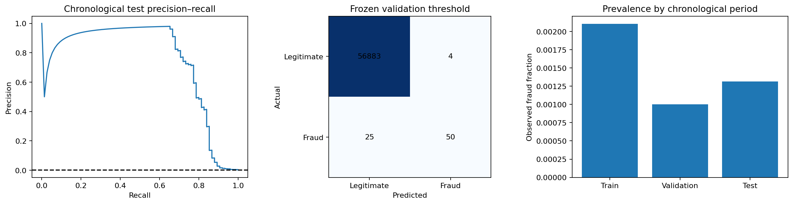

# Card fraud on actual transactions

How well does a classifier identify rare fraud in a later period without balancing or thresholding the test data?

## Data and provenance

- [ULB/Worldline European card transactions, TensorFlow public tutorial mirror](https://storage.googleapis.com/download.tensorflow.org/data/creditcard.csv): 284,807 input rows. All 284,807 transactions retained; no rebalancing or synthetic rows. Chronological 60/20/20 split ordered by Time; original PCA features are provider-generated. Two-day sample is not a production performance guarantee. Raw SHA-256: `76274b691b16a6c49d3f159c883398e03ccd6d1ee12d9d8ee38f4b4b98551a89`.

## Design

All 284,807 original transactions remain at natural prevalence. Stable Time order defines 60/20/20 train/validation/test blocks. Scalers fit within the training pipeline; unweighted and balanced logistic models are selected by validation average precision. Validation F1 selects a threshold, frozen for test. No model is refit after threshold selection. PCA coordinates come from the original provider, and Time is used for ordering rather than as a predictor. Recall includes a descriptive Wilson interval.

## Results

| Measure | Value |
|---|---:|
| transactions | 284807 |
| train transactions | 170884 |
| validation transactions | 56961 |
| test transactions | 56962 |
| test fraud cases | 75 |
| test prevalence | 0.00131667 |
| selected_class_weight | balanced |
| validation selected threshold | 0.999977 |
| test average precision | 0.74377 |
| test roc auc | 0.982004 |
| test brier | 0.0232173 |
| test precision | 0.925926 |
| test recall | 0.666667 |
| recall wilson ci low | 0.554174 |
| recall wilson ci high | 0.762918 |
| false positives | 4 |
| false negatives | 25 |
| true positives | 50 |
| train end time | 120396 |
| validation start time | 120396 |
| validation end time | 145247 |
| test start time | 145248 |

## Assumptions and limitations

Only two historical days and few held-out fraud cases are available. Chronological splits share boundary timestamps, although stable row ordering preserves disjoint records. Provider-generated PCA transformations cannot be reconstructed or audited for their original fitting population. Delayed fraud confirmation, cardholder grouping, economic costs and future domain shift are unavailable. A validation-F1 threshold is an analysis choice, not a production cost optimum; high ROC AUC does not establish operational suitability.
