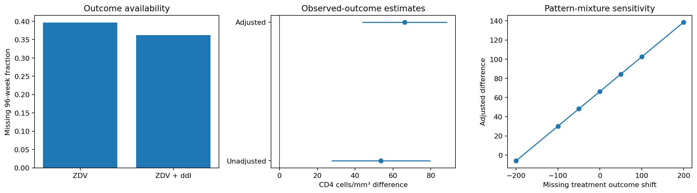

# ACTG 175: baseline adjustment and missing follow-up

What is the observed 96-week CD4 difference between randomized ZDV+ddI and ZDV arms, and how sensitive is it to missing outcomes?

## Data and provenance

- [ACTG 175 randomized HIV trial, CRAN speff2trial distribution](https://raw.githubusercontent.com/cran/speff2trial/master/data/ACTG175.txt): 2,139 input rows. Original 2,139 participants. Analysis preselects arms 0 (ZDV) and 1 (ZDV+ddI), 96-week CD4 endpoint cd496, baseline cd40, age, and prior-antiretroviral stratum. Missing follow-up remains missing; no postrandomization predictors. Raw SHA-256: `7b52e6b3701a1f24090ef0388f1c148d5286450f97276d9c8fbe611ce0c76779`.

## Design

ANCOVA adjusts for baseline CD4, age and original prior-antiretroviral stratum; these are preassignment variables. HC3 sandwich uncertainty is reported alongside an unadjusted complete-case comparison. A pattern-mixture analysis imputes conditional means for missing outcomes, shifts only missing treatment-arm outcomes by a stated delta, then refits. The sensitivity curve gives point estimates, not multiple-imputation intervals.

## Results

| Measure | Value |
|---|---:|
| randomized selected arms | 1054 |
| observed 96 week outcomes | 654 |
| missing fraction | 0.379507 |
| adjusted cd4 difference | 66.2393 |
| hc3 ci low | 43.8311 |
| hc3 ci high | 88.6475 |
| unadjusted cd4 difference | 53.6354 |
| sensitivity delta minus200 | -6.09608 |
| sensitivity delta plus200 | 138.575 |

## Assumptions and limitations

Randomization does not make complete-case outcomes unbiased when follow-up is missing. Conditional ignorability and mean-model adequacy remain assumptions. Delta values are scenarios in CD4 cells/mm³, not observed effects. Trial strata are not sites. Treatment discontinuation, death and clinical-event mechanisms require a fuller estimand strategy. This historical educational reanalysis is not medical guidance or an efficacy recommendation. Cite ACTG 175 and the CRAN speff2trial data distribution; preserve their attribution and terms.
