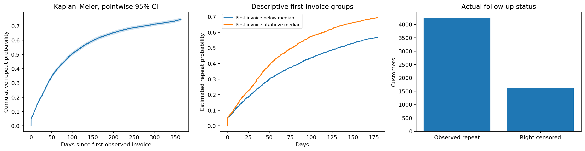

# Time to repeat purchase in real retail invoices

How quickly do identified retail customers place a second observed invoice, accounting for incomplete follow-up?

## Data and provenance

- [UCI Online Retail II real invoices (2009-2011)](https://archive.ics.uci.edu/static/public/502/online+retail+ii.zip): 36,969 input rows. Positive-value noncancelled invoices with observed customer ID, duplicate lines removed; aggregate all timestamps for the same customer/invoice, using earliest timestamp and summed value. First observed purchase is entry, next distinct invoice is event. Left-truncation/history and competing-event limitations apply; no churn labels invented. Raw SHA-256: `572e36277c2390fbfde10664750731e0a86f55e33470d91919085f0408e67bfb`.

## Design

A customer enters at their first observed positive noncancelled invoice. The next distinct invoice is the event; customers without one are administratively right censored at the last dataset timestamp. Kaplan–Meier product-limit survival uses event-before-censor handling at tied times, Greenwood log-log pointwise intervals, and restricted mean waiting time through 90 days. A predeclared median first-invoice split describes heterogeneity without fitting a predictive or causal treatment model.

## Results

| Measure | Value |
|---|---:|
| customers | 5878 |
| observed second invoices | 4255 |
| right censored | 1623 |
| censored fraction | 0.276114 |
| estimated repeat by 30d | 0.233279 |
| estimated repeat by 90d | 0.476905 |
| estimated repeat by 180d | 0.63287 |
| restricted mean wait 90d | 63.1481 |
| at risk day90 | 2795 |
| median first invoice value | 294.795 |

## Assumptions and limitations

This replaces unavailable KKBox data with real Online Retail II transactions. The outcome is observed repeat purchase, not churn, inactivity or subscription cancellation. First observed purchase may belong to an existing customer, and invoices split at the same time can count as repeats. Customer-ID missingness, excluded returns/cancellations and seasonal/cohort effects limit generalization. Kaplan–Meier assumes independent censoring; administrative follow-up may correlate with entry season. Group comparisons are descriptive, not causal. No synthetic event times or business outcomes are used.
