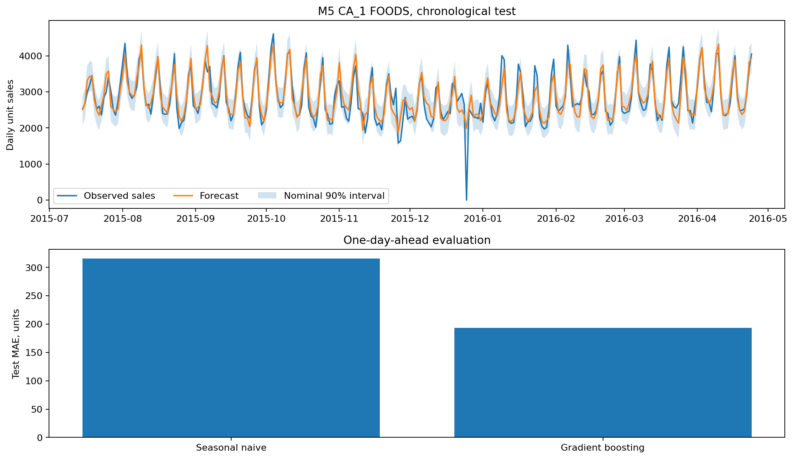

# Real retail sales forecasting with calibrated intervals

Can a calendar-and-lag model improve one-day CA_1 food-category sales forecasts over last-week sales?

## Data and provenance

- [M5 Walmart daily unit sales, CA_1 FOODS category](https://huggingface.co/datasets/kashif/M5/resolve/main/sales_train_validation.csv): 1,913 input rows. All FOODS items in CA_1 aggregated before modeling, d_1 through d_1913. Mirror MD5 26a366a25beb57b0a8f4c7b148758f94 matches original Zenodo 10203108. Calendar downloaded from same public mirror. Observed sales, not unconstrained demand. Raw SHA-256: `f368e66ed1dbecb48b2cc8fc589bf68b3deddbbb36bf5c88b4d6d0a09b9b6724`.

## Design

All input lags and rolling statistics use strictly earlier observations. Chronological train/validation/calibration/test blocks contain 1200/200/200/285 days after a 28-day warm-up. Validation selects tree complexity; train+validation refits the final model, calibration alone sets an absolute-error interval radius, and test remains untouched. This is rolling one-day forecasting: earlier observed test sales may enter later lags, while model parameters and intervals stay fixed.

## Results

| Measure | Value |
|---|---:|
| source days | 1913 |
| train days | 1200 |
| validation days | 200 |
| calibration days | 200 |
| test days | 285 |
| selected leaves | 7 |
| test mae | 193.327 |
| seasonal naive mae | 316.014 |
| test rmse | 269.429 |
| nominal interval coverage | 0.9 |
| empirical interval coverage | 0.905263 |
| calibration radius units | 415.424 |

## Assumptions and limitations

Historical observed sales may be constrained by inventory and cannot identify latent demand. Current-day calendar events and SNAP are assumed known. Time dependence violates exchangeability, so split-conformal-style intervals do not have an unconditional time-series coverage guarantee; empirical coverage is reported. The preselected category/store aggregate is not evidence for all M5 products or horizons. Download used a public mirror with the original sales-file MD5 verified against Zenodo record 10203108.
