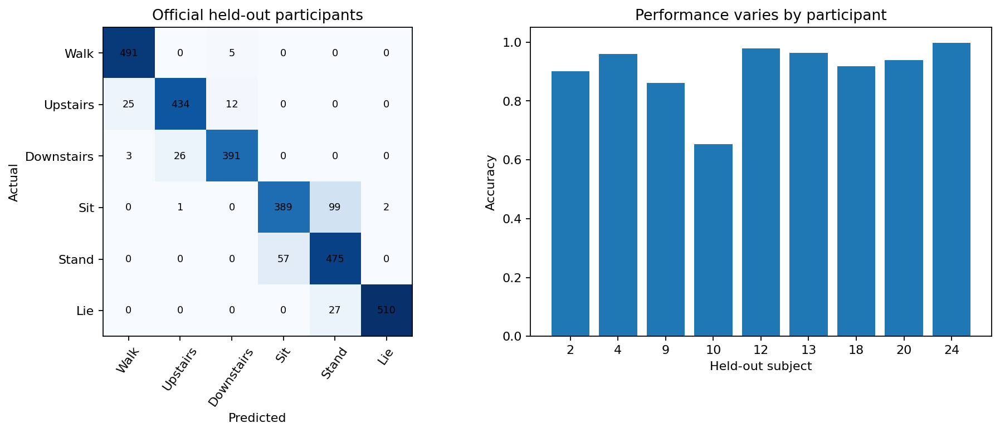

# Smartphone activity recognition with held-out people

Can a compact motion-feature model generalize to participants never seen during fitting or selection?

## Data and provenance

- [UCI Human Activity Recognition Using Smartphones](https://archive.ics.uci.edu/static/public/240/human+activity+recognition+using+smartphones.zip): 10,299 input rows. All 10,299 official windows; fixed 66 time- and frequency-domain mean/std features selected by feature name, not outcomes. Official participant-separated test split retained; train validation separated by subject. Overlapping windows within subjects are never split across folds. Raw SHA-256: `c00b803081a5c797cd5e4b83700a9810b38d53d9d84e01917e090e1fdbc81031`.

## Design

The official UCI train/test participants remain separate. A grouped validation split inside the official training participants selects logistic regularization by macro F1. Scaling fits only on the fitting subjects; the chosen pipeline refits on all official training participants before one test evaluation. The 66 predeclared time- and frequency-domain mean/std features are selected by their published names, independently of labels. Accuracy, macro F1, confusion matrix and participant-level performance are all reported.

## Results

| Measure | Value |
|---|---:|
| total windows | 10299 |
| prespecified features | 66 |
| fit subjects | 15 |
| validation subjects | 6 |
| official train subjects | 21 |
| official test subjects | 9 |
| official test windows | 2947 |
| selected c | 0.1 |
| test accuracy | 0.912793 |
| test macro f1 | 0.914068 |
| worst test subject accuracy | 0.653061 |

## Assumptions and limitations

Overlapping sensor windows within a participant are dependent; window counts are not independent people. There are only nine held-out test participants, so uncertainty and generalization remain limited. The study covers six scripted activities on a specific phone placement and does not establish safety, clinical validity or performance in unrestricted movement. No random window-level train/test split or synthetic sensor readings are used. Cite Anguita et al. and the UCI HAR dataset.
