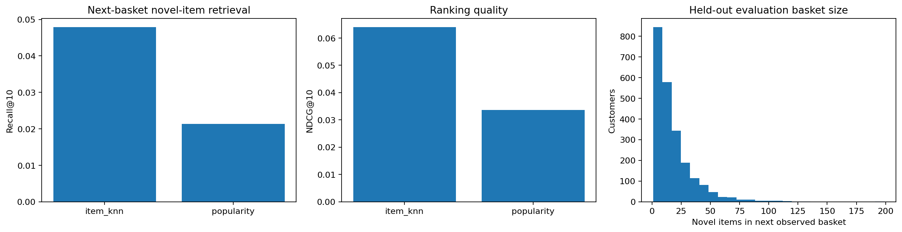

# Real purchase recommendations with chronological evaluation

Can item co-purchase similarity recommend novel products in the next observed basket better than popularity?

## Data and provenance

- [UCI Online Retail II real purchase interactions](https://archive.ics.uci.edu/static/public/502/online+retail+ii.zip): 768,873 input rows. Positive noncancelled identified-customer invoices. Duplicate customer/invoice/item removed. Train before 2011-07-01, evaluation July-November 2011; product recommendation replaces simulated logistics interactions. All ranking candidates and similarities derived exclusively from training. Raw SHA-256: `572e36277c2390fbfde10664750731e0a86f55e33470d91919085f0408e67bfb`.

## Design

Binary customer-item purchases before April 2011 build a validation model; April–June next baskets select 20 versus 50 cosine neighbors. Final fitting uses only purchases before July 2011, and July–November next observed baskets form the test. Items require five distinct training customers. Evaluation includes customers with at least two training items and a novel held-out item; previously purchased products are excluded from ranking. Both methods share candidates and users. Relevant unseen-catalog products remain in recall denominators, and catalog coverage is reported.

## Results

| Measure | Value |
|---|---:|
| purchase item rows | 768873 |
| training rows | 550097 |
| test period purchase rows | 202102 |
| training catalog items | 3834 |
| evaluated customers | 2276 |
| selected neighbors | 20 |
| item knn recall at10 | 0.0479267 |
| popularity recall at10 | 0.0213824 |
| item knn ndcg at10 | 0.0639984 |
| popularity ndcg at10 | 0.0335433 |
| item knn precision at10 | 0.0518014 |
| heldout novel item catalog coverage | 0.835784 |

## Assumptions and limitations

This replaces simulated logistics interactions with actual retail purchase recommendation. Purchase co-occurrence is observational and does not identify incremental sales. Evaluation conditions on customers who return and have a novel item, so it does not describe all shoppers or cold-start users. The source retailer has wholesale customers and large baskets. First held-out basket is the next observed invoice, not necessarily the next real-world purchase. Ranking has no inventory, price or user-preference counterfactuals; no synthetic ratings, likes or business gains are claimed.
