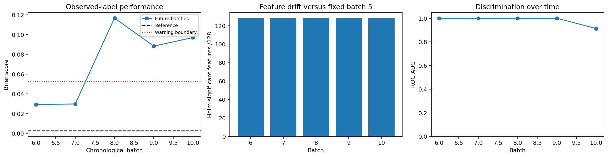

# Monitoring real gas sensor drift over chronological batches

How does a frozen sensor classifier change across future acquisition batches, and do feature diagnostics track performance?

## Data and provenance

- [UCI Gas Sensor Array Drift Dataset, Vergara et al.](https://archive.ics.uci.edu/static/public/224/gas+sensor+array+drift+dataset.zip): 13,910 input rows. All original batches and labels retained. Binary gas classes 1 and 2 preselected for monitoring; batches 1-3 train, 4 validation, 5 fixed reference, 6-10 monitoring. Batch index is observed chronology; no known concept-shift labels are asserted. Research-only source restriction respected; cite Vergara et al. Raw SHA-256: `91e8f466f202e7a093d657673ce47311c3e90416f7df3057966058961c351fe4`.

## Design

Gas classes 1 and 2 are fixed before fitting. Batches 1–3 train and batch 4 selects logistic regularization by Brier score. The refit on batches 1–4 is frozen; batch 5 supplies reference diagnostics and an explicit engineering warning threshold of reference Brier plus 0.05. Batches 6–10 are evaluated without refitting. Each batch compares all 128 original features to the same reference using two-sample KS, Holm correction within that batch, and reference-quantile PSI with half-count smoothing.

## Results

| Measure | Value |
|---|---:|
| train rows | 1541 |
| validation rows | 107 |
| reference rows | 68 |
| monitoring rows | 3775 |
| monitoring batches | 5 |
| selected c | 0.01 |
| reference brier | 0.00252861 |
| mean future brier | 0.054136 |
| batches with feature drift | 5 |
| batches with brier warning | 3 |
| drift features per batch | 128 |

## Assumptions and limitations

These are real laboratory sensor measurements, not customer/business monitoring. There are no ground-truth covariate/concept-shift regime labels. KS/PSI detect distribution differences and do not identify a causal reason or prove concept drift. Holm correction is within batch, not across repeated future monitoring; correlated readings and sample sizes influence tests. Labels are available in the benchmark; no real-world label arrival delay is claimed. The Brier warning boundary is a documented scenario rule, not a calibrated false-alarm guarantee. Source restricts use to research and requires Vergara et al. attribution.
