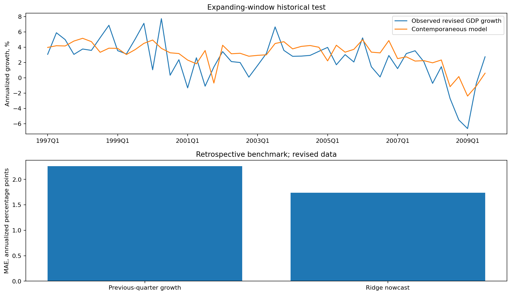

# Retrospective macroeconomic nowcasting with real data

Can contemporaneous macro indicators improve a current-quarter GDP-growth estimate over previous-quarter growth?

## Data and provenance

- [Statsmodels US macroeconomic data, 1959Q1-2009Q3](https://raw.githubusercontent.com/statsmodels/statsmodels/main/statsmodels/datasets/macrodata/macrodata.csv): 203 input rows. All 203 quarterly observations from statsmodels macrodata. Revised historical series: a retrospective contemporaneous GDP-growth model, not an as-of-vintage or deployable real-time evaluation. Current-quarter predictors assumed observed; publication lags are not modeled. Raw SHA-256: `d93c0d3a7a77ef83c3af14e46032bb1d02ae3a512b22ab94159a8ca226fcf708`.

## Design

GDP and disposable-income growth use annualized log changes. Current-quarter income growth, unemployment change, inflation and Treasury rate accompany lagged GDP growth. An initial 100-quarter history supports a 50-quarter expanding-window validation block that selects ridge regularization. The final 51-quarter test refits only on preceding target quarters at each origin. Standardization is refit inside each historical training window.

## Results

| Measure | Value |
|---|---:|
| raw quarters | 203 |
| initial training quarters | 100 |
| validation quarters | 50 |
| test quarters | 51 |
| selected ridge alpha | 100 |
| test mae annualized pct points | 1.73819 |
| lag growth baseline mae | 2.26237 |
| test rmse annualized pct points | 2.14049 |
| test_first_quarter | 1997Q1 |
| test_last_quarter | 2009Q3 |

## Assumptions and limitations

The source contains revised historical quarterly data, not release vintages. Current-quarter predictor availability is assumed, and prior GDP observations may include later revisions. This is therefore a retrospective contemporaneous benchmark, not a point-in-time real-time nowcast or evidence of a deployable release-calendar advantage. The series ends in 2009Q3 and does not describe current economic conditions. Small samples and the financial crisis constrain generalization; no trading or investment performance is claimed.
