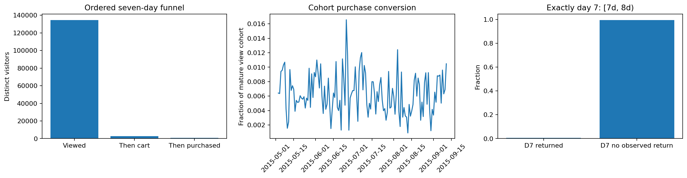

# Real ecommerce events: ordered funnels and return cohorts

Where do observed visitors leave a view-to-cart-to-purchase funnel, and how many return on day 7?

## Data and provenance

- [Retailrocket real ecommerce event log, public Hugging Face mirror](https://huggingface.co/datasets/DanielKiani/RetailRocket-Recommender-Data/resolve/main/data/RetailRocket-Recommender-Data/data/events.csv): 272,943 input rows. Original view/addtocart/transaction events. Predeclared visitorid modulo 10 equals zero subset, retaining all events for each selected visitor (about 10%). No generated sessions, channels, checkout steps or purchases. Descriptive visitor cohort analysis, not population inference. Original: https://www.kaggle.com/datasets/retailrocket/ecommerce-dataset; mirror preserves original schema. Observe upstream dataset attribution and noncommercial research terms where applicable. Raw SHA-256: `3745aa83238b1e6d44d8fda209807899f420084398f94ddf745f3cbcfecbf9e7`.

## Design

SQLite CTEs identify each visitor’s first observed view, first subsequent cart within seven days, and first purchase after that cart within the same seven-day origin window. The visitor-level funnel may span items; it is not an item conversion funnel. Cohorts too near the dataset end are excluded. D7 return is any recorded event in [7,8) days after first view, requiring eight full observation days. SQL counts distinct visitors and preserves one row per origin.

## Results

| Measure | Value |
|---|---:|
| observed events | 272943 |
| selected visitors | 140758 |
| mature 7day view cohort | 134526 |
| ordered cart visitors | 2878 |
| ordered purchase visitors | 864 |
| view to cart rate | 0.0213936 |
| ordered view to purchase rate | 0.00642255 |
| d7 mature visitors | 133344 |
| d7 return rate | 0.00513709 |
| followup days funnel | 7 |

## Assumptions and limitations

This is descriptive observational event analysis, not an experiment or a causal attribution model. First observed view is not proven signup or first-ever visit; the observation boundary creates left censoring. Missing tracked events and cross-device identity can change rates. No checkout stage or marketing channel is invented. The deterministic visitor subset preserves full observed histories but is not a probability sample of customers. Raw source event order is explicitly sorted rather than assumed.
