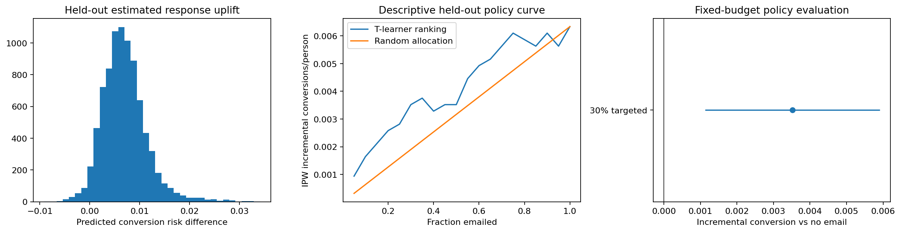

# Campaign response uplift on a real randomized experiment

Can a 30% email budget target incremental conversions more effectively than a random allocation?

## Data and provenance

- [Kevin Hillstrom email marketing randomized experiment (2008)](http://www.minethatdata.com/Kevin_Hillstrom_MineThatData_E-MailAnalytics_DataMiningChallenge_2008.03.20.csv): 64,000 input rows. Original 64,000 rows; both pipelines preselect Mens E-Mail versus No E-Mail. Womens E-Mail is excluded before analysis. Two-week conversion outcome; no retention or lifetime-value labels are invented. Raw SHA-256: `0e5893329d8b93cefecc571777672028290ab69865718020c78c7284f291aece`.

## Design

The original randomized Mens E-Mail and No E-Mail arms supply known conditional assignment propensity 0.5. Separate outcome models form a T-learner using preassignment features only. Train fits, validation selects a learner by fixed-budget IPW incremental conversion, and train+validation refits once. Test outcomes never choose model, budget or allocation. Stable score ranking allocates 30% of held-out customers. Influence-based uncertainty compares the selected policy with no email. The curve is descriptive, not a second selection exercise.

## Results

| Measure | Value |
|---|---:|
| train customers | 25567 |
| validation customers | 8523 |
| test customers | 8523 |
| selected_learner | forest |
| test contact fraction | 0.299894 |
| ipw incremental conversion vs no email | 0.00351989 |
| ipw ci low | 0.00113104 |
| ipw ci high | 0.00590874 |
| random 30pct incremental conversion | 0.00190074 |
| treat all incremental conversion | 0.0063358 |
| test observed conversion | 0.00926904 |

## Assumptions and limitations

This is response uplift, not long-term retention. Individual causal effects are unobservable; there is no true-uplift RMSE. No contact cost, profit or lifetime value is fabricated. Randomization, consistency and no interference identify policy value in this historical sample. The simple interval conditions on the learned policy and is not simultaneous across budgets; sparse conversions make estimates noisy. A selected learner need not beat a random policy. The 30% budget is a scenario assumption, not an observed business constraint.
