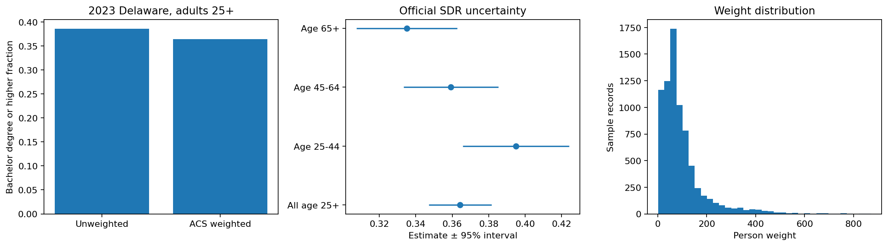

# ACS education estimates with official survey weights

What share of Delaware residents age 25+ held at least a bachelor degree in the 2023 ACS?

## Data and provenance

- [2023 ACS 1-year Delaware person PUMS](https://www2.census.gov/programs-surveys/acs/data/pums/2023/1-Year/csv_pde.zip): 7,554 input rows. Age >=25 domain, original education, sex, person weights and all 80 successive-difference replicate weights. Estimate bachelor degree or higher (SCHL>=21). No synthetic population or response process. Raw SHA-256: `16eff294fea42cccac9dab8e63c2e2a0eef83569f8f8106862f22ebca09af447`.

## Design

The domain is selected using actual age. The education indicator uses SCHL>=21. Ratio estimates apply original PWGTP; uncertainty uses all 80 official successive-difference replicate weights with variance 4/80 times the sum of squared deviations from the full-weight estimate. The same estimator is recomputed within age domains. Two-sided normal 95% intervals are unbounded Wald intervals; none are near the bounds in this analysis.

## Results

| Measure | Value |
|---|---:|
| sample adults 25plus | 7554 |
| weighted population 25plus | 730263 |
| unweighted bachelors or higher | 0.385888 |
| weighted bachelors or higher | 0.364284 |
| sdr standard error | 0.00877654 |
| ci low | 0.347082 |
| ci high | 0.381486 |
| kish weight concentration n | 3858.93 |
| replicate weights | 80 |

## Assumptions and limitations

PUMS estimates can differ from published ACS tables because of disclosure protection and microdata construction. Replicate weights represent the survey design and weight adjustments; they are not independent samples. Kish effective n summarizes weight concentration only and is not a design-adjusted effective sample size. No known population truth, observed response propensity, causal claim or synthetic nonresponse mechanism is asserted. Geography and year are fixed before analysis.
